---

# 🤖 Dual-Robot Collaborative Chess Simulation in Webots

An autonomous multi-robot chess simulation built with **Cyberbotics Webots**, featuring two **Universal Robots UR10e** robotic arms equipped with vacuum grippers. The robots autonomously take turns executing chess moves, handling piece captures (eliminations), and navigating complex 3D clearance trajectories above the chessboard without collisions.

---

## 🌟 Key Features

* **Dual-Robot Turn Coordination**: File-based synchronization (`shared_turn.txt`) guarantees turn-based mutual exclusion so both robots never move simultaneously or collide in mid-air.
* **Autonomous Piece Capture (Elimination)**: Supports capture moves. When a piece is taken, the active robot picks up the captured piece, carries it off the board into an organized table graveyard, and then executes its move.
* **Synchronized Joint Trajectories (Anti-Sag)**: Dynamically scales individual motor velocities so all 6 joints finish their motion simultaneously, eliminating the mid-air arm sag that causes mid-flight collisions.
* **Hierarchical 2-Step Elevator Motion**:
  * **Z = 0.50 m (Cruise)**: High-altitude flight safely above all pieces.
  * **Z = 0.30 m (Staging)**: Vertical elevator alignment directly over target squares.
  * **Z = 0.15 m - 0.18 m (Touchdown)**: Calibrated surface heights for pawns, knights, bishops, rooks, queens, and kings.
* **180° Backward Park Posture**: Arms fold safely backward away from the chessboard when idle, preventing physical interference.
* **4-Point Rigid Vacuum Gripper**: Uses a 4-point planar contact model in Webots to eliminate piece dangling or tilting during flight.

---

## 🛠️ System Architecture & Flowchart

The following state machine governs the behavior of both robots:

```mermaid
flowchart TD
    %% Global & Init
    Start(["Simulation Start"]) --> Init["Initialize Webots Robot / Supervisor<br/>Detect Role: White (Ranks 1-4) or Black (Ranks 5-8)"]
    Init --> IK_Setup["Export Robot URDF & Build IK Chain (ikpy)<br/>Enforce Crane Bounds: Shoulder (-2.8, 0.0), Elbow (0.1, 2.8)"]
    IK_Setup --> ParkStartup["STARTUP_LIFT -> STARTUP_PAN<br/>Swing arms backward to DEFAULT_PARK_POSTURE (-1.571 rad)"]
    ParkStartup --> Idle["IDLE Stage<br/>Read shared_turn.txt"]

    %% Turn Check
    Idle --> TurnCheck{"Is it my turn?<br/>(is_my_move)"}
    TurnCheck -- "No" --> Idle
    TurnCheck -- "Yes" --> SolveWaypoints["Calculate World (X, Y) Coordinates<br/>Lookup Piece Top Z Heights<br/>Solve IK Waypoints at 0.50m, 0.30m & Touch Z"]

    SolveWaypoints --> SwingFace["SWING_TO_BOARD<br/>Rotate arm to face board (+1.571 rad)"]
    SwingFace --> PauseFace["PAUSE_FACING_BOARD<br/>Hold 0.5s for stabilization"]

    %% Elimination Branch
    PauseFace --> ElimCheck{"Does move require<br/>Elimination first?<br/>(elim_str is not None)"}

    %% Elimination Sub-flow
    subgraph Elimination_Process ["1. Capture / Elimination Sub-Process"]
        ElimCheck -- "Yes" --> Elim_Fly["ELIM_APPROACH_CRUISE: Fly over enemy piece at 0.50m"]
        Elim_Fly --> Elim_Clear["ELIM_APPROACH_CLEAR: Drop to 0.30m staging"]
        Elim_Clear --> Elim_Touch["ELIM_TOUCH_DESCEND: Touch piece (suction OFF)"]
        Elim_Touch --> Elim_Grip["ELIM_SUCTION: Turn suction ON & confirm seal"]
        Elim_Grip --> Elim_LiftClear["ELIM_LIFT_CLEAR: Lift straight up to 0.30m"]
        Elim_LiftClear --> Elim_LiftCruise["ELIM_LIFT_CRUISE: Rise to 0.50m cruise altitude"]
        Elim_LiftCruise --> Elim_Transfer["ELIM_TRANSFER: Fly across board at 0.50m to Graveyard"]
        Elim_Transfer --> Elim_DropClear["ELIM_STAGE_CLEAR: Drop to 0.30m overhead graveyard"]
        Elim_DropClear --> Elim_Place["ELIM_TOUCH_PLACE: Lower to table surface"]
        Elim_Place --> Elim_Release["ELIM_RELEASE: Cut suction & increment discard_count"]
        Elim_Release --> Elim_Retract["ELIM_RETRACT: Retract vertically back to 0.50m"]
    end

    %% Normal Move Process
    ElimCheck -- "No (Normal Move)" --> Normal_Fly["APPROACH_CRUISE: Fly overhead Source Piece at 0.50m"]
    Elim_Retract --> Normal_Fly

    subgraph Normal_Move_Process ["2. Standard Pick & Place Process"]
        Normal_Fly --> Norm_Clear["APPROACH_CLEAR: Lower to 0.30m staging"]
        Norm_Clear --> Norm_Touch["TOUCH_DESCEND: Lower onto piece head (suction OFF)"]
        Norm_Touch --> Norm_Pick["TOUCH_PICK: Turn suction ON when seated flat"]
        Norm_Pick --> Norm_Seal["SUCTION: Verify vacuum seal"]
        Norm_Seal --> Norm_LiftClear["LIFT_CLEAR: Lift vertically to 0.30m"]
        Norm_LiftClear --> Norm_LiftCruise["LIFT_CRUISE: Rise to 0.50m cruise altitude"]
        Norm_LiftCruise --> Norm_Transfer["TRANSFER: Fly high at 0.50m with Synchronized Speeds<br/>(No mid-air sag!)"]
        Norm_Transfer --> Norm_StageClear["STAGE_CLEAR: Arrived overhead target square -> Drop to 0.30m"]
        Norm_StageClear --> Norm_Place["TOUCH_PLACE: Lower gently to board (0.15m - 0.17m)"]
        Norm_Place --> Norm_Release["RELEASE: Turn suction OFF & wait 0.5s for pressure release"]
        Norm_Release --> Norm_Retract["RETRACT: Retract straight up to 0.30m"]
    end

    %% Return & Advance Turn
    Norm_Retract --> ReturnPark["RETURN<br/>Swing smoothly back to backward DEFAULT_PARK_POSTURE"]
    ReturnPark --> AdvanceTurn["Write Next Turn to shared_turn.txt<br/>(Turn + 1)"]
    AdvanceTurn --> Idle
```



---

## 📂 Project Directory Structure

```text
my_first_simulation/
├── controllers/
│   └── ur10e_chess/
│       ├── ur10e_chess.py         # Main autonomous Python robot controller
│       ├── shared_turn.txt        # Inter-process turn synchronization file
│       ├── ur10e_skeleton_b.urdf  # Exported URDF kinematic model for Black Robot
│       └── ur10e_skeleton_w.urdf  # Exported URDF kinematic model for White Robot
├── worlds/
│   ├── chessbot.wbt               # Main Webots 3D simulation world
│   ├── 3d_models/                 # High-resolution STL/STEP models of chess pieces
│   │   ├── pawn.stl, knight.stl, bishop.stl, rook.stl, queen.stl, king.stl
│   └── textures/                  # Textures for chessboard and table
└── README.md
```

---

## 📦 Requirements & Installation

1. **Cyberbotics Webots**: Version R2025a or later ([Download Webots](https://cyberbotics.com/)).
2. **Python**:
3. **Required Python Packages**:
   Install the kinematic and mathematical libraries:
   ```bash
   pip install ikpy numpy
   ```

---

## 🚀 How to Run the Simulation

1. Launch **Webots**.
2. Go to **File -> Open World...** and select:
   ```text
   worlds/chessbot.wbt
   ```
3. Press the **Play (Run)** button at the top of the Webots interface.
4. The robots will initialize, swing into their safe parking postures, and begin executing moves from `move_queue` in turn order.

---

## ⚙️ Move Queue Configuration

Moves are scheduled in `controllers/ur10e_chess/ur10e_chess.py` inside the `move_queue` list:

```python
move_queue = [
    # Normal move: (source, destination)
    ("e2", "e4"),
    
    # Capture move: (source, destination, captured_square)
    ("h8", "a1", "a1"),  # Eliminates white piece on A1 first, then moves H8 to A1!
]
```

* **Standard Moves** take 2 strings: `("src", "dst")`.
* **Capture Moves** take 3 strings: `("src", "dst", "elim")`. The robot will automatically clear the piece at `"elim"` to the off-board graveyard before carrying out the move.

---

## 📐 Piece Touchdown Calibrations

| Piece Type | Touchdown Height ($Z$) |
| :--- | :--- |
| **Pawns** | `0.145m` |
| **Bishops / Rooks / Queen** | `0.165m` |
| **Knights** | `0.173m` |
| **Kings** | `0.178m` |

## 🍿 Simulation


https://github.com/user-attachments/assets/4bb16b9c-3135-48fa-9ae5-9bd04799ca3c

