# ♟️ Dual UR10e Robot Chess Simulation

An autonomous robotics project built in **Webots** where two **UR10e robotic arms** work together to play chess on a physical 3D board. 

The robots use vacuum suction grippers to pick up pieces, carry them across the board, take captured pieces off the board, and execute moves sent in real time from a **Camera Vision / Chess AI engine**.

---

## 🎯 What Does This Project Do?

1. **Two Robots, One Board**:
   * **White Robot**: Controls White pieces (ranks 1 to 4).
   * **Black Robot**: Controls Black pieces (ranks 5 to 8).
   * They coordinate so only one arm moves at a time—preventing any mid-air crashes.

2. **Real-Time Communication with Vision / AI**:
   * The robots do not need to be restarted after each turn. They stay running continuously in a waiting (`IDLE`) state.
   * When a camera detects a human move or an AI engine calculates a countermove, it sends commands like `"e2 to e4"` over a network socket or file. The robot receives it and executes it immediately.

3. **Piece Capture & Elimination**:
   * If a move is a capture (e.g. a Knight takes a Pawn), the robot first picks up the captured piece, carries it off the board to an organized table "graveyard," releases it, and then makes the attacking move.

4. **Castling Support**:
   * Castling involves moving both the King and the Rook. Since a robot arm has only one gripper, the code automatically splits castling into two smooth steps: King moves first, followed immediately by the Rook.

5. **Smooth & Safe Motion (Anti-Sag Control)**:
   * Normally, robotic joints move at different speeds, which can cause the arm to "sag" down in mid-flight and knock pieces over. Our code synchronizes all 6 joint motors so the arm flies completely flat at a safe altitude ($0.50\text{m}$) across the board.

6. **Dynamic Piece Height Memory**:
   * A King is tall ($0.178\text{m}$), while a Pawn is short ($0.145\text{m}$). The code tracks where pieces move across all 64 squares throughout the game so the gripper always descends to the exact right height without crashing or hovering in the air.

---

## 🔄 How the Whole Process Works (Flowchart)

```mermaid
flowchart TD
    %% 1. Startup
    Start(["Start Simulation"]) --> Setup["Initialize Webots & Arm Motors<br/>Identify Role: White Robot or Black Robot"]
    Setup --> Park["Fold Arms Backward (-1.571 rad)<br/>Safe Parking Pose (Clear of Board)"]
    Park --> Idle["IDLE Stage<br/>Listening for moves from Vision / AI"]

    %% 2. Receiving
    Idle --> Listen{"New Move Command Received?<br/>(e.g., 'e2 to e4' or 'e4 takes d5')"}
    Listen -- "No" --> Idle
    Listen -- "Yes" --> CheckPartner{"Is the other robot moving?"}
    CheckPartner -- "Yes (Busy)" --> WaitPartner["Wait safely in IDLE"] --> CheckPartner
    CheckPartner -- "No (Clear)" --> StartMove["Claim Turn & Set Status: BUSY"]

    %% 3. Planning
    StartMove --> Plan["Look up Piece Height on Square<br/>Calculate 3D Coordinates (X, Y, Z)<br/>Solve Motor Angles (Inverse Kinematics)"]
    Plan --> FaceBoard["Swing Arm Forward to Face Chessboard<br/>Hold 0.5s to stabilize"]

    %% 4. Decision: Capture or Normal?
    FaceBoard --> IsCapture{"Is this a Capture Move?"}

    %% 4A. Elimination
    subgraph Elimination_SubProcess ["Capture / Elimination Step"]
        IsCapture -- "Yes" --> FlyEnemy["Fly high at 0.50m directly over Enemy Piece"]
        FlyEnemy --> DropEnemy["Drop down like an elevator & turn Suction ON"]
        DropEnemy --> LiftEnemy["Lift enemy piece straight up to 0.50m"]
        LiftEnemy --> DiscardEnemy["Fly off the board to Table Graveyard"]
        DiscardEnemy --> PlaceGraveyard["Lower piece to table & turn Suction OFF"]
        PlaceGraveyard --> RetractGraveyard["Retract arm back up to 0.50m"]
    end

    %% 4B. Normal Move
    IsCapture -- "No" --> FlySource["Fly high at 0.50m directly over My Piece"]
    RetractGraveyard --> FlySource

    subgraph Normal_Move_Process ["Standard Move Step"]
        FlySource --> DropSource["Drop straight down to 0.30m, then touch piece"]
        DropSource --> GripPiece["Turn Suction ON & Confirm Vacuum Seal"]
        GripPiece --> LiftHigh["Lift piece straight up to 0.50m cruise height"]
        LiftHigh --> Transfer["Transfer across the board at 0.50m<br/>(Synchronized speeds: NO mid-air dipping!)"]
        Transfer --> ArriveDest["Arrive directly overhead Destination Square"]
        ArriveDest --> DropDest1["Elevator Step 1: Lower to 0.30m staging height"]
        DropDest1 --> DropDest2["Elevator Step 2: Lower gently to board surface"]
        DropDest2 --> ReleasePiece["Turn Suction OFF & Wait 0.5s for pressure drop"]
        ReleasePiece --> RetractUp["Retract straight up to 0.30m"]
    end

    %% 5. Finish
    RetractUp --> ReturnHome["Swing arm backward to Parking Posture"]
    ReturnHome --> Finish["Update Piece Position in Memory<br/>Signal Status: READY for next move"]
    Finish --> Idle
```



---

## 🚀 How to Run the Project

### 1. Requirements
* [Cyberbotics Webots](https://cyberbotics.com/) (R2025a or newer)
* Python installed with required libraries:
  ```bash
  pip install ikpy numpy
  ```

### 2. Start the Simulation
1. Launch **Webots**.
2. Click **File $\rightarrow$ Open World...** and select `simulation/worlds/chessbot.wbt`.
3. Click the **Play** button at the top of Webots.
4. Both robots will initialize, swing backward to their safe parking poses, and enter `IDLE` mode.

### 3. Send a Move from Python
In your vision/engine script, send a move command using TCP socket or file bridge:

```python
import socket

# Send move to Black Robot (port 10001) or White Robot (port 10002):
s = socket.socket(socket.AF_INET, socket.SOCK_STREAM)
s.connect(("127.0.0.1", 10002))  # White robot

# Standard Move:
s.sendall(b'{"action": "MOVE", "player": "white", "src": "e2", "dst": "e4"}\n')

# Capture Move (takes piece on d5 first):
# s.sendall(b'{"action": "MOVE", "player": "white", "src": "e4", "dst": "d5", "elim": "d5"}\n')

s.close()
```

The robot executes the move, places the piece dead-center, signals `READY`, and waits for the next turn!

Note: Webots -> Runs once, stays open forever in the background.
This Script (step 3) : Run it whenever you want to trigger a move. It shoots the command into Webots over the local network socket.

### 🎬 Video


https://github.com/user-attachments/assets/61e0c650-3be6-4788-a5d0-3992ce670789


```
